# Linguagem como sistema complexo

**Previsibilidade, lei de Zipf e emergência: o que os romances de Machado de Assis mostram sobre os grandes modelos de linguagem**

Seminário e artigo da disciplina **SCX 5002 · Sistemas Complexos I** (USP EACH), por Hercules Ramos.

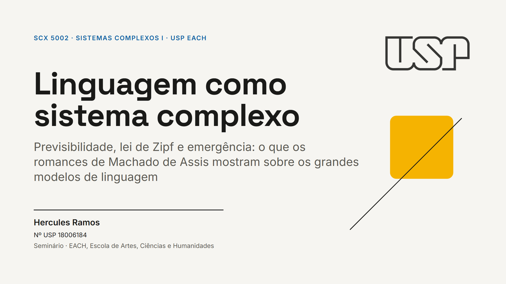

---

## Sumário

- [A pergunta](#a-pergunta)
- [Resultados em uma tabela](#resultados-em-uma-tabela)
- [O corpus](#o-corpus)
- [Ideia 1 · Previsibilidade (entropia)](#ideia-1--previsibilidade-entropia)
- [Ideia 2 · Lei de Zipf e modelos nulos](#ideia-2--lei-de-zipf-e-modelos-nulos)
- [Ideia 3 · Emergência e parâmetro de ordem](#ideia-3--emergência-e-parâmetro-de-ordem)
- [A apresentação](#a-apresentação)
- [Estrutura do repositório](#estrutura-do-repositório)
- [Como reproduzir](#como-reproduzir)
- [Métodos e ferramentas](#métodos-e-ferramentas)
- [Limitações](#limitações)
- [Referências principais](#referências-principais)

---

## A pergunta

A linguagem pode ser vista como um **sistema complexo adaptativo**: muitos falantes interagem sem coordenação central, e a estrutura da língua emerge do uso. Os grandes modelos de linguagem (LLMs) aprendem essa estrutura prevendo o próximo símbolo, e a literatura relata que algumas de suas habilidades "surgem" de repente quando os modelos crescem.

> Quando um LLM parece ganhar uma habilidade de repente, isso é uma **transição de fase**, no sentido da física estatística, ou um **efeito da métrica** usada para medir o desempenho?

Para responder com dados, o trabalho mede **três ideias** num mesmo corpus, os dez romances de Machado de Assis, e compara linguagem humana e modelos **apenas por grandezas observáveis no texto** (frequências, incerteza de previsão, curvas de desempenho), sem supor que os mecanismos sejam os mesmos.

| | |
| --- | --- |
| 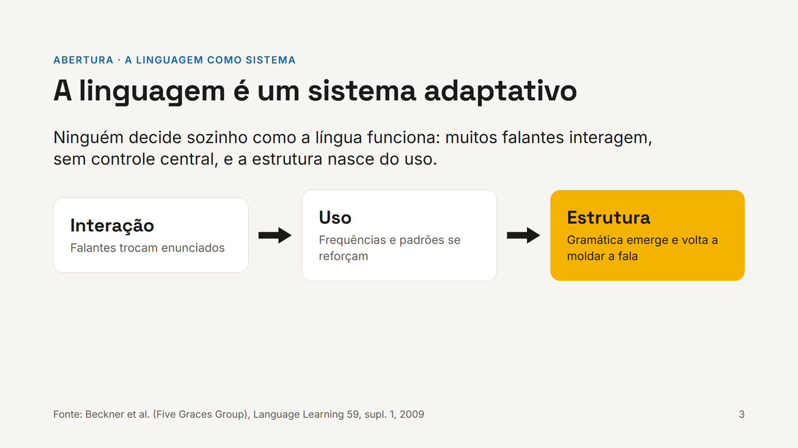 | 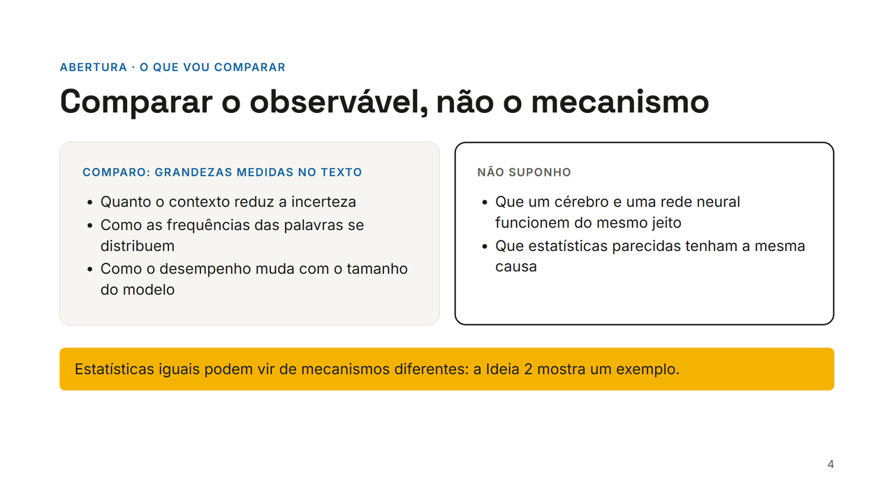 |

## Resultados em uma tabela

| Ideia | Resultado principal |
| --- | --- |
| **1. Previsibilidade** | Com 5 letras de contexto, **1,93 bit por caractere** (1,86 a 2,01 entre romances), contra 4,75 sem informação: redundância de pelo menos **59%** |
| **2. Lei de Zipf** | **α = 1,00** por máxima verossimilhança (IC 95%: 0,99 a 1,02); de 0,97 a 1,14 conforme a faixa. Uma digitação aleatória também dá α ≈ 1,05: **o expoente não identifica mecanismo** |
| **3. Emergência** | O parâmetro de ordem φ (acerto por caractere) cresce **suave**; o acerto exato de 10 letras parece "surgir" de repente. **O salto está na métrica**, não no sistema |

Todos os números do artigo, dos slides e deste README vêm de [`results/resultados.json`](results/resultados.json), gerado por [`src/analise.py`](src/analise.py) com semente fixa (42).

## O corpus

Os dez romances de Machado de Assis, de *Ressurreição* (1872) a *Memorial de Aires* (1908), na *Obra Completa* (Nova Aguilar, 1994), em domínio público e distribuídos pelo NLTK (corpus `machado`).

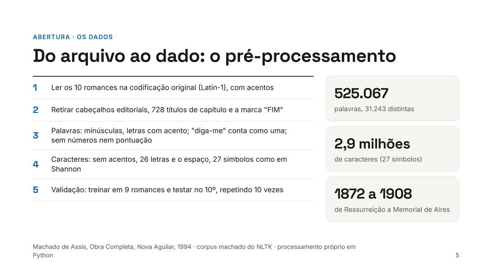

| Grandeza | Valor |
| --- | --- |
| Palavras (após pré-processamento) | 525.067 |
| Palavras distintas | 31.243 |
| Palavras que aparecem uma só vez (hapax) | 14.665 (46,9% do vocabulário) |
| Cinco mais frequentes (a, que, de, e, o) | 17,4% das ocorrências |
| Caracteres (alfabeto de 27 símbolos) | 2.917.027 |

**Pré-processamento**, registrado passo a passo no script:

1. Leitura em Windows-1252, a codificação original dos arquivos.
2. Remoção do cabeçalho editorial (título, "Texto-fonte", "Publicado originalmente").
3. Remoção das 728 linhas "CAPÍTULO ..." e da marca final "FIM". Prefácios do autor são mantidos.
4. **Palavras:** minúsculas, letras com acento e hífen interno ("diga-me" é uma palavra).
5. **Caracteres:** sem acentos, tudo que não é letra vira espaço. Alfabeto de 27 símbolos (26 letras + espaço), como em Shannon (1951).
6. **Validação cruzada:** treino em 9 romances e teste no 10º, repetido 10 vezes.

Resumo de cada romance em [`docs/romances.md`](docs/romances.md).

## Ideia 1 · Previsibilidade (entropia)

**A intuição.** Imagine adivinhar a próxima letra de um texto com perguntas de sim ou não. A **entropia** é o número médio de perguntas necessárias, em bits. Sem nenhuma informação, com 27 símbolos igualmente prováveis, são log₂ 27 ≈ 4,75 perguntas. Conhecendo as letras anteriores, são bem menos: depois de "pens", o "a" é quase certo. Essa é também a tarefa de treino de um LLM: minimizar a **entropia cruzada** do próximo símbolo.

| | |
| --- | --- |
|  |  |

**A medida.** Modelos de n-gramas de caracteres com contexto de k = 0 a 8 letras, interpolação de Witten-Bell, treinados em 9 romances e avaliados no 10º.

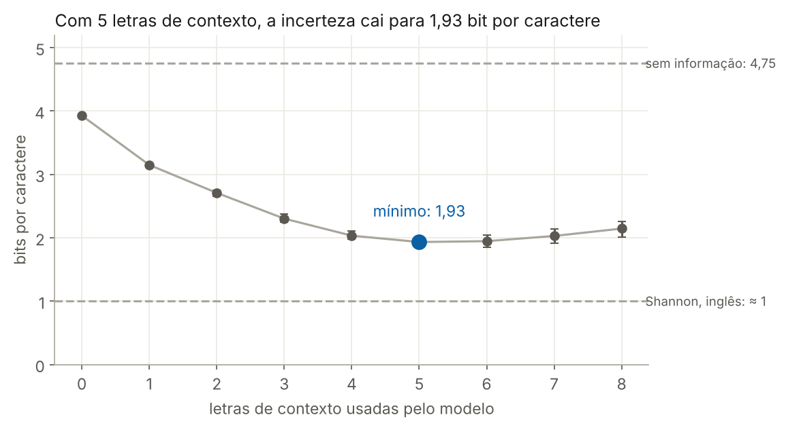

- Melhor estimativa: **1,93 bit/caractere com 5 letras de contexto** (faixa entre romances: 1,86 a 2,01).
- Redundância de pelo menos **59%** (1 − 1,93/4,75).
- A partir de 6 letras a medida volta a subir: os contextos longos ficam raros demais e o modelo passa a decorar. O valor é limitado pelo corpus e pelo tipo de modelo, não pela língua.

## Ideia 2 · Lei de Zipf e modelos nulos

**A intuição.** Ordenando as palavras da mais para a menos frequente, a frequência cai aproximadamente como 1/posto^α. Em escala log-log, isso é uma reta de inclinação −α.

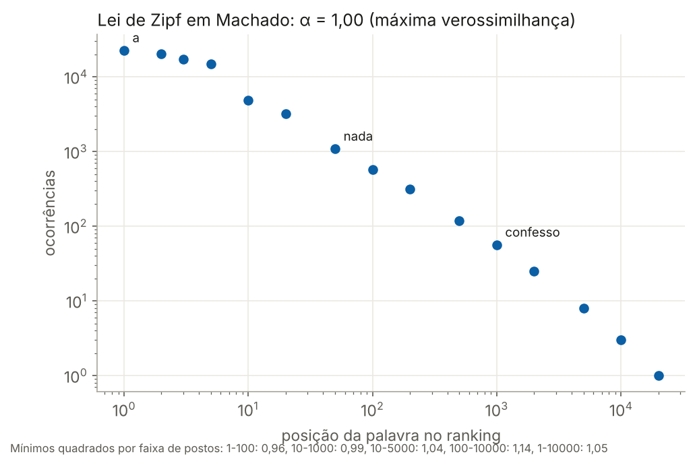

**O expoente e suas incertezas.** O valor de α depende de como ele é estimado:

| Método | Dados do ajuste | α | Incerteza |
| --- | --- | --- | --- |
| Mínimos quadrados log-log | postos 1 a 100 | 0,97 | R² = 0,975 |
| Mínimos quadrados log-log | postos 10 a 1.000 | 0,99 | R² = 0,997 |
| Mínimos quadrados log-log | postos 10 a 5.000 | 1,04 | IC 95% (bootstrap): 1,037 a 1,041 |
| Mínimos quadrados log-log | postos 100 a 10.000 | 1,14 | R² = 0,997 |
| Máxima verossimilhança (Clauset et al.) | 725 palavras com ≥ 82 ocorrências | **1,00** | IC 95%: 0,99 a 1,02; KS = 0,024 |
| Um romance por vez | postos 10 a 1.000 | 0,99 a 1,04 | média 1,01; DP 0,02 |

A **incerteza estatística é pequena (±0,02)**, mas a **incerteza de método é grande (0,97 a 1,14)**. Resumo honesto: α = 1,0 ± 0,1.

| | |
| --- | --- |
| 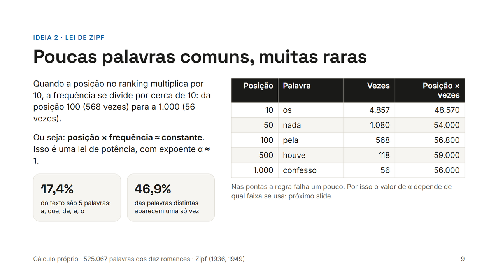 | 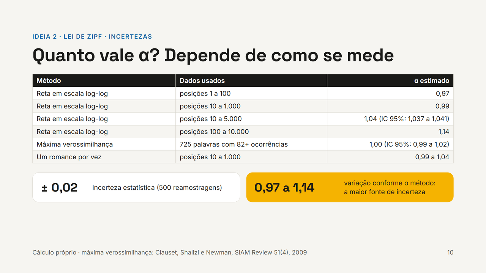 |

**O que α ≈ 1 não demonstra.** O mesmo ajuste foi aplicado a dois textos artificiais do mesmo tamanho:

- **Digitação aleatória:** cada caractere sorteado de forma independente, com as frequências de Machado. Sem gramática nem memória.
- **Texto gerado por n-gramas:** cada caractere sorteado conforme as 4 letras anteriores. Parece português de longe ("tinuou de petua e tragos que nao seu com agrimas"), mas 79% das "palavras" produzidas não existem no corpus.

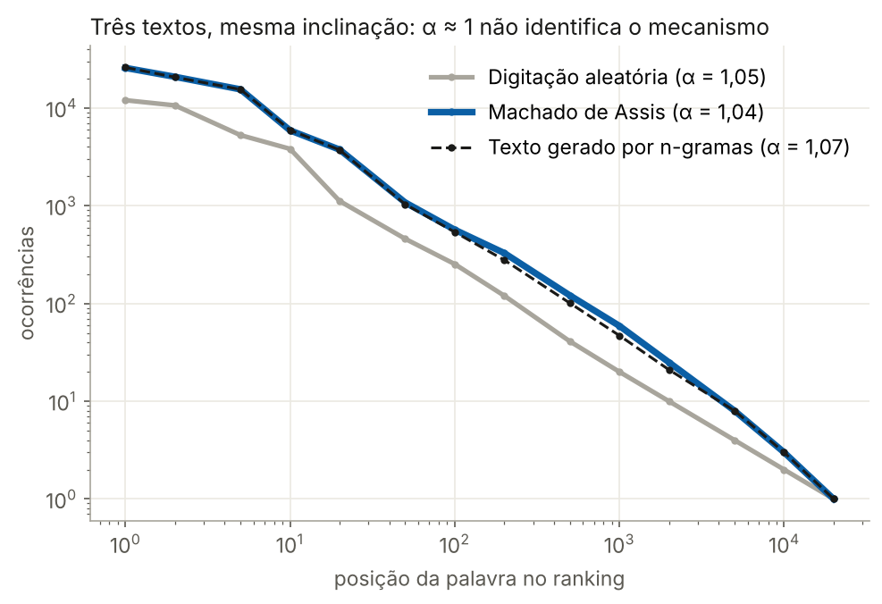

Os três textos têm inclinações próximas (1,04, 1,05 e 1,07). Portanto, α ≈ 1, isoladamente, **não identifica o mecanismo** que gerou o texto e **não é evidência de criticalidade**.

## Ideia 3 · Emergência e parâmetro de ordem

**O fenômeno.** Wei et al. (2022) chamam de emergente uma habilidade ausente em modelos menores e presente nos maiores, e descrevem a mudança como transição de fase. Schaeffer, Miranda e Koyejo (2023) observam que essas habilidades se concentram em métricas de **tudo ou nada**: se cada símbolo sai certo com probabilidade p, uma resposta de L símbolos sai inteira certa com probabilidade ≈ p^L, e uma melhora suave de p vira uma subida abrupta de p^L.

**Definições**, por analogia com o modelo de Ising:

| Elemento | Neste trabalho | No modelo de Ising |
| --- | --- | --- |
| Sistema | Modelos de n-gramas de caracteres (contexto k = 0 a 8) | Ímãs numa rede |
| Variável de controle | log₁₀ do número de parâmetros (27 a 2,7 milhões) | Temperatura |
| Parâmetro de ordem φ | Fração das letras de teste que o modelo acerta | Magnetização |
| Métrica de tarefa m_L | Acerto exato de L letras seguidas, ≈ φ^L | Função não linear da magnetização |

**Critério de transição:** haveria transição se o próprio φ mudasse de repente num tamanho crítico, com a suscetibilidade χ = dφ/d(log N) divergindo ali.

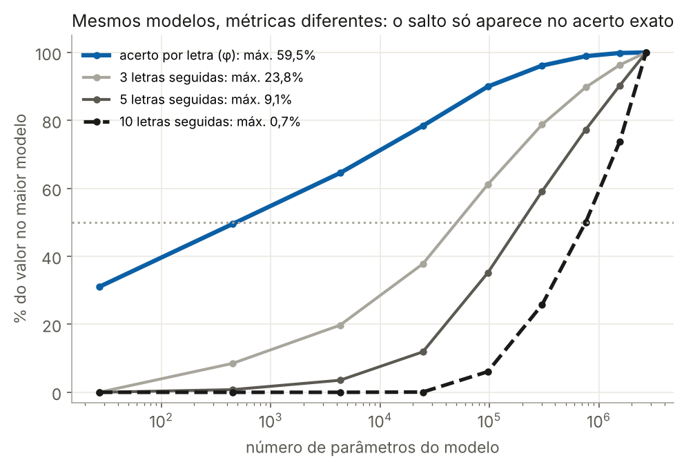

- φ cresce de forma **suave**: de 18,4% (sem contexto) a 59,5% (8 letras), atingindo metade do valor final com ~450 parâmetros.
- O acerto exato de 10 letras fica em zero até ~25 mil parâmetros e só chega à metade do valor final perto de 760 mil: visto sozinho, **parece surgir de repente**.
- φ^10 = 0,56% contra 0,73% medidos: a fórmula explica o salto.
- A suscetibilidade tem um máximo largo (0,12 por década, ~50 mil parâmetros) e cai para 0,004. Sem divergência: é um **crossover**, não uma transição de fase.

| | |
| --- | --- |
| 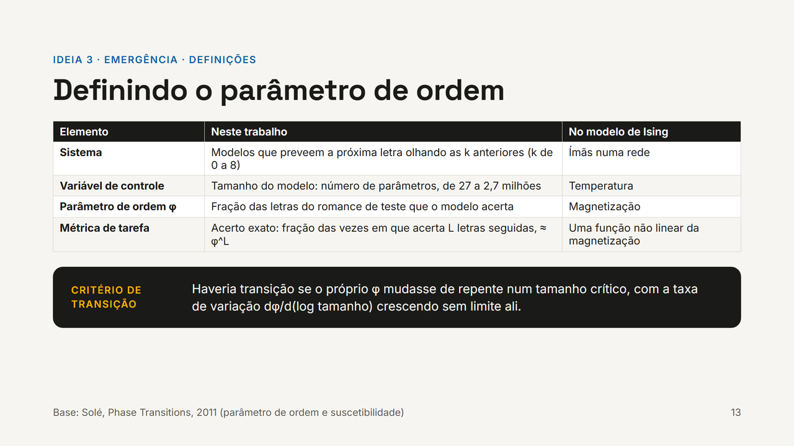 | 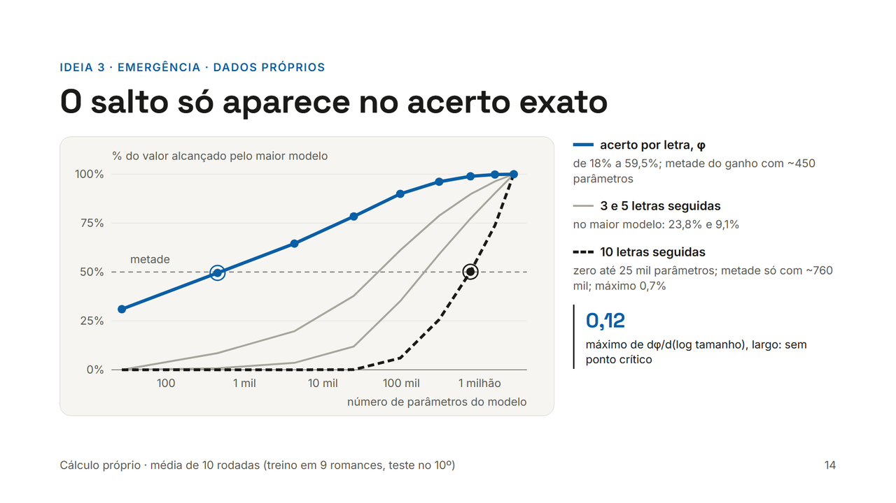 |

O experimento **não** prova que toda emergência em LLMs é ilusória (um n-grama não é um LLM). Ele estabelece um **procedimento**: para afirmar transição de fase num LLM, é preciso exibi-la num parâmetro de ordem contínuo, e não apenas numa métrica de acerto exato.

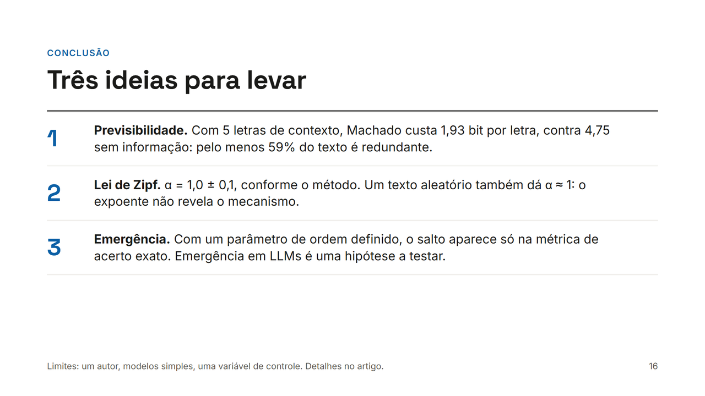

## A apresentação

Seminário pré-gravado de **18 minutos**, 18 slides em 1920 × 1080, com notas do apresentador em cada slide e roteiro de fala completo em [`docs/roteiro.md`](docs/roteiro.md).

- [`apresentacao/apresentacao.html`](apresentacao/apresentacao.html): todos os slides com as notas abaixo de cada um (abrir no navegador).
- [`apresentacao/apresentacao.pdf`](apresentacao/apresentacao.pdf): versão em PDF.

<details>
<summary><b>Ver os 18 slides</b></summary>

| | |
| --- | --- |
|  | 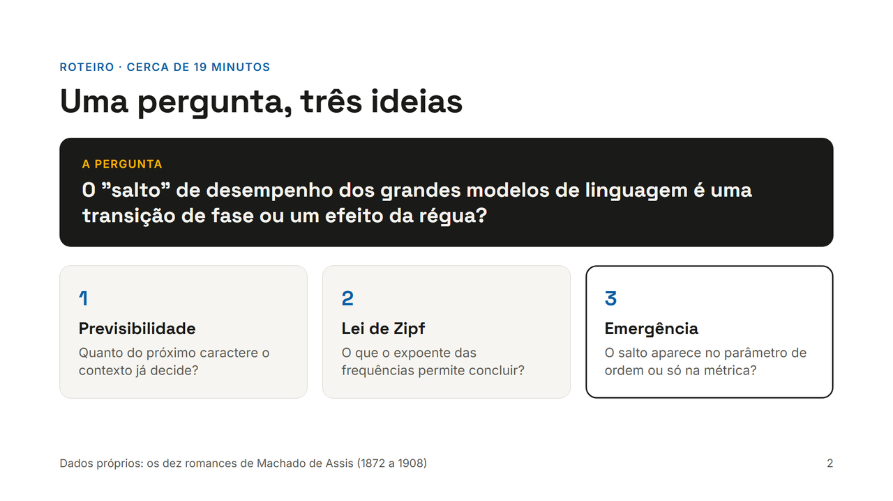 |
|  |  |
|  |  |
| 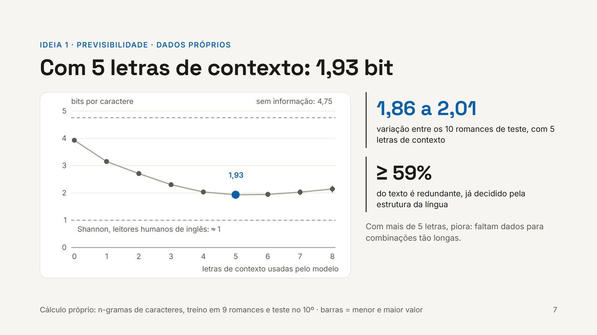 |  |
|  |  |
| 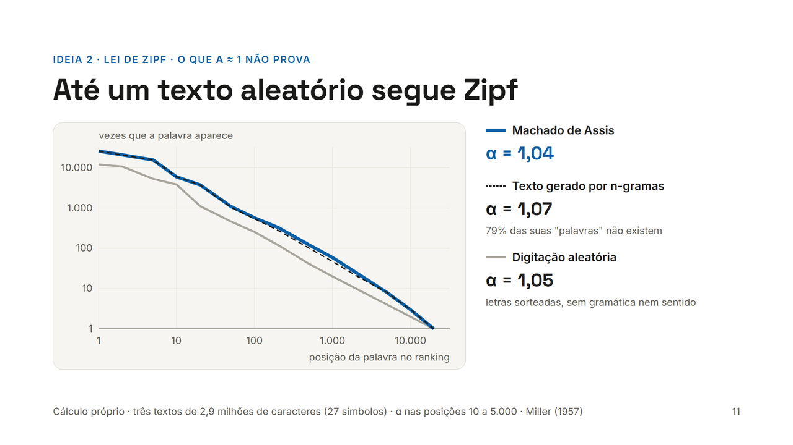 | 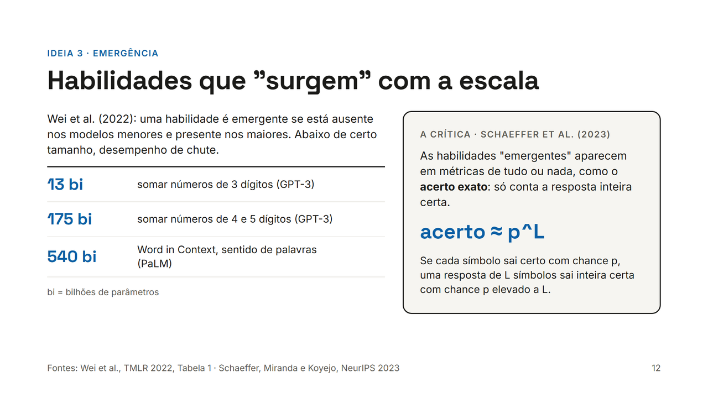 |
|  |  |
|  |  |
| 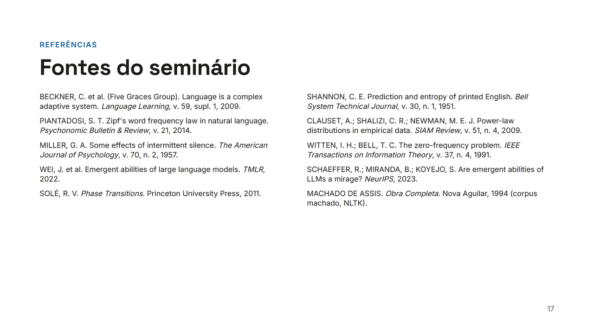 | 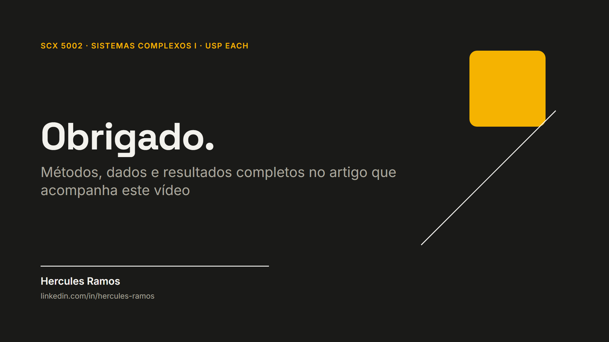 |

</details>

## Estrutura do repositório

```
.
├── README.md                    este arquivo
├── requirements.txt             dependências Python
├── src/
│   ├── baixar_corpus.py         baixa o corpus "machado" do NLTK para data/raw/
│   ├── analise.py               análise completa -> results/resultados.json
│   ├── figuras.py               figuras do artigo -> figuras/*.png
│   ├── montar_apresentacao.py   slides -> apresentacao/apresentacao.html (e .pdf)
│   └── gerar_prints.py          prints dos slides -> docs/prints/*.png
├── data/                        corpus baixado (fora do git, ver data/README.md)
├── results/resultados.json      todos os números do artigo e dos slides
├── figuras/                     4 figuras do artigo em PNG
├── docs/
│   ├── artigo.md                artigo completo
│   ├── roteiro.md               roteiro de fala de 18 minutos, slide a slide
│   ├── proposta.md              proposta, feedback do professor e ajustes feitos
│   ├── romances.md              os dez romances, com resumos
│   ├── metodologia.md           ferramentas e métodos
│   └── prints/                  um PNG por slide, usados neste README
├── apresentacao/
│   ├── deck.json                ordem e seções dos slides
│   ├── slides/*.html            um slide por arquivo (1920 × 1080), notas em <aside>
│   ├── assets/                  fontes (Space Grotesk, Inter) e logo da USP
│   ├── apresentacao.html        apresentação montada, com notas
│   └── apresentacao.pdf         versão em PDF (18 páginas)
└── legado/analise_v1.py         análise da proposta original, antes do feedback
```

| Documento | Conteúdo |
| --- | --- |
| [`docs/artigo.md`](docs/artigo.md) | Artigo completo: introdução, corpus, as três ideias, discussão, limitações e referências |
| [`docs/roteiro.md`](docs/roteiro.md) | Fala de ~2.300 palavras, com tempo por slide e tempo acumulado |
| [`docs/proposta.md`](docs/proposta.md) | Proposta original, feedback do professor e como cada ajuste foi atendido |
| [`docs/metodologia.md`](docs/metodologia.md) | Ferramentas, etapas da análise e diferenças em relação à versão inicial |
| [`docs/romances.md`](docs/romances.md) | Os dez romances, com ano, número de palavras e resumo |

## Como reproduzir

Requisitos: Python 3.10+ e acesso à internet para baixar o corpus. Rodar tudo **a partir da raiz do repositório**.

```bash
python -m venv .venv
source .venv/bin/activate          # Windows: .venv\Scripts\activate
pip install -r requirements.txt
```

```bash
python src/baixar_corpus.py              # baixa os 10 romances (domínio público) para data/raw/
python src/analise.py                    # 1 a 2 minutos -> results/resultados.json
python src/figuras.py                    # -> figuras/*.png
python src/montar_apresentacao.py        # -> apresentacao/apresentacao.html
```

Opcional, exportar o PDF e os prints dos slides (requer Playwright):

```bash
pip install playwright && playwright install chromium
python src/montar_apresentacao.py --pdf  # também gera apresentacao/apresentacao.pdf
python src/gerar_prints.py               # -> docs/prints/*.png
```

A semente aleatória é fixa (42): `analise.py` reproduz os mesmos números do `results/resultados.json` versionado (só o campo de tempo de execução muda).

## Métodos e ferramentas

Todo o estudo usa **Python 3, NumPy e a biblioteca padrão**; nenhuma biblioteca de PLN ou de aprendizado de máquina. Os modelos de linguagem foram implementados do zero.

| Etapa | Método |
| --- | --- |
| Zipf | Mínimos quadrados log-log em cinco faixas (pontos espaçados logaritmicamente); máxima verossimilhança discreta de Clauset, Shalizi e Newman (2009) com f_min por Kolmogorov-Smirnov; bootstrap com 500 reamostragens multinomiais |
| Modelos nulos | Digitação aleatória i.i.d. e texto gerado por n-gramas de 4 letras, com o mesmo ajuste de Zipf |
| Entropia | N-gramas de caracteres (k = 0 a 8), interpolação de Witten-Bell, validação cruzada por romance |
| Parâmetro de ordem | Acerto por caractere φ, acerto exato de L = 1, 3, 5, 10 letras, suscetibilidade por diferenças finitas |
| Figuras | Matplotlib |
| Apresentação | Slides em HTML montados por script; PDF e prints via Playwright (Chromium) |

Detalhes em [`docs/metodologia.md`](docs/metodologia.md). A versão anterior ao feedback do professor (entropia no próprio texto de treino, compressão, informação mútua) está em [`legado/analise_v1.py`](legado/analise_v1.py), mantida só como histórico.

## Limitações

- **Um autor, uma época:** ~meio milhão de palavras de prosa literária do século XIX.
- **Modelos simples:** 1,93 bit/caractere é uma cota superior, limitada pelo corpus e pelo tipo de modelo.
- **Pré-processamento:** remover acentos e tratar formas com hífen como uma palavra alteram levemente as medidas.
- **Uma variável de controle:** varia o tamanho do contexto, não o volume de dados; o teste de estreitamento com o tamanho do sistema ficou como próximo passo.
- **LLMs reais não foram avaliados:** a discussão se apoia em resultados publicados.

## Referências principais

- Beckner et al. (Five Graces Group). Language is a complex adaptive system. *Language Learning* 59, 2009.
- Shannon, C. E. Prediction and entropy of printed English. *Bell System Technical Journal* 30, 1951.
- Piantadosi, S. T. Zipf's word frequency law in natural language. *Psychonomic Bulletin & Review* 21, 2014.
- Clauset, Shalizi e Newman. Power-law distributions in empirical data. *SIAM Review* 51, 2009.
- Wei et al. Emergent abilities of large language models. *TMLR*, 2022.
- Schaeffer, Miranda e Koyejo. Are emergent abilities of large language models a mirage? *NeurIPS*, 2023.
- Solé, R. V. *Phase Transitions*. Princeton University Press, 2011.

Lista completa em [`docs/artigo.md`](docs/artigo.md#referências).

## Dados e licença dos textos

Os textos de Machado de Assis (1839 a 1908) estão em domínio público. O corpus não é versionado; [`src/baixar_corpus.py`](src/baixar_corpus.py) o baixa de `github.com/nltk/nltk_data` (ver [`data/README.md`](data/README.md)).

## Autor

Hercules Ramos · aluno especial, USP EACH · [linkedin.com/in/hercules-ramos](https://linkedin.com/in/hercules-ramos)
