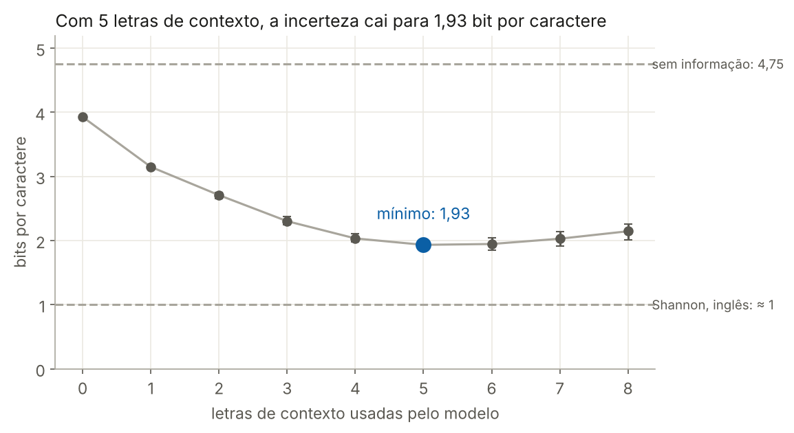
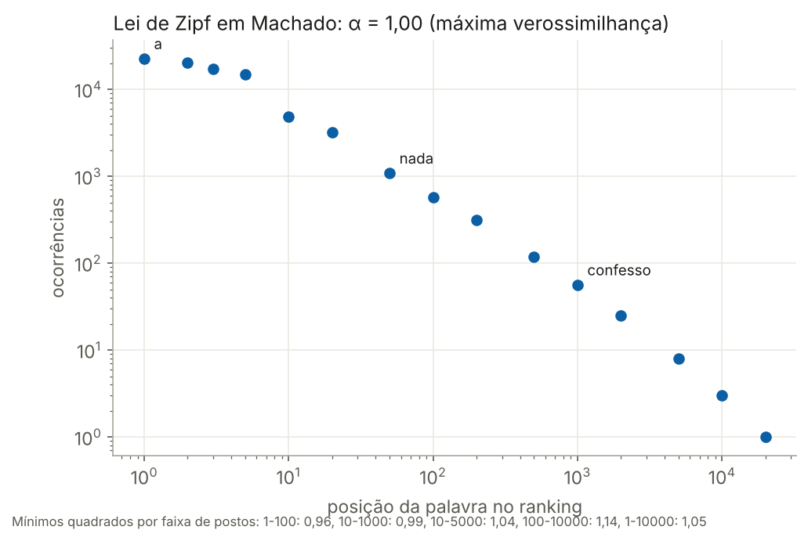
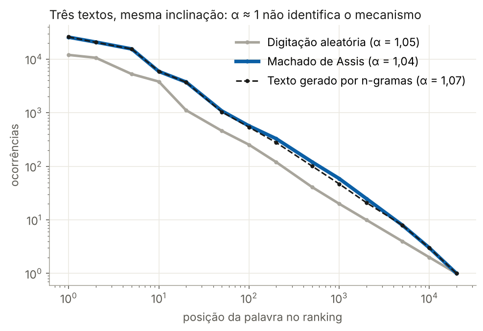
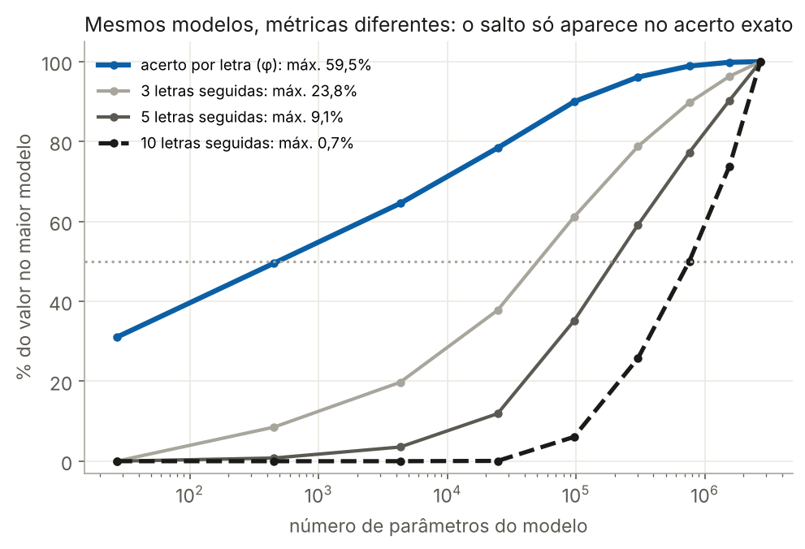

# Linguagem como sistema complexo: leis de potência, informação e emergência, do texto humano aos grandes modelos de linguagem

Hercules Ramos · SCX 5002 Sistemas Complexos I · USP EACH · Nº USP 18006184 · outubro de 2026

## Resumo

Este artigo trata a linguagem natural como sistema complexo adaptativo e investiga três ideias, medidas nos dez romances de Machado de Assis (525.067 palavras). Primeira: a previsibilidade do texto. Com validação cruzada entre romances, a incerteza sobre o próximo caractere cai de 3,93 para 1,93 bit (faixa entre romances: 1,86 a 2,01) quando o modelo considera as 5 letras anteriores. Segunda: a lei de Zipf. O expoente estimado vai de 0,97 a 1,14 conforme a faixa de ajuste; por máxima verossimilhança, α = 1,00 (IC 95%: 0,99 a 1,02). Modelos nulos, como uma digitação aleatória, produzem expoentes semelhantes, o que mostra que α ≈ 1, sozinho, não identifica um mecanismo nem indica criticalidade. Terceira: a emergência em grandes modelos de linguagem (LLMs). Define-se um parâmetro de ordem, a taxa de acerto por caractere φ, e uma variável de controle, o logaritmo do número de parâmetros do modelo. Em modelos de n-gramas treinados no corpus, φ cresce de forma suave, enquanto a métrica de acerto exato de 10 caracteres seguidos parece "surgir" de repente. O salto está na métrica, não no parâmetro de ordem. A comparação com LLMs se limita a semelhanças observáveis, sem supor mecanismos geradores comuns.

**Palavras-chave:** sistemas complexos; linguagem natural; entropia; lei de Zipf; parâmetro de ordem; modelos de linguagem.

## 1. Introdução

A linguagem pode ser vista como um sistema complexo adaptativo: muitos falantes interagem sem coordenação central, e a estrutura da língua emerge do uso e volta a moldar o uso futuro ([Beckner et al., 2009](https://deepblue.lib.umich.edu/items/ee9de13a-38e2-498e-8920-c21829345596/full)). Os grandes modelos de linguagem (LLMs) aprendem essa estrutura a partir de textos, e a literatura relata que algumas de suas habilidades "surgem" de repente quando os modelos crescem ([Wei et al., 2022](https://ar5iv.arxiv.org/html/2206.07682)). A pergunta deste trabalho é: **essa emergência corresponde a uma transição de fase, no sentido da física estatística, ou é um efeito da métrica usada para medir o desempenho?**

Para responder com dados e sem dispersar a exposição, o artigo se concentra em três ideias, todas medidas no mesmo corpus:

1. **Previsibilidade (informação).** Quanto do próximo caractere já está determinado pelo contexto? A grandeza é a entropia, e ela é também o que um LLM minimiza no treino.
2. **Leis de potência (lei de Zipf).** Qual é o expoente da distribuição de frequências das palavras, com que incerteza, e o que ele permite ou não permite concluir?
3. **Emergência e parâmetro de ordem.** Com um parâmetro de ordem definido com precisão e uma variável de controle explícita, um "salto" de desempenho aparece no parâmetro de ordem ou só na métrica?

Temas discutidos na proposta original, como a lei de Heaps, as correlações de longo alcance e as leis de escala de LLMs em detalhe, ficaram fora do escopo.

**O que se compara.** Linguagem humana e LLMs são comparados apenas por **grandezas observáveis no texto**, como frequências, incerteza de previsão e curvas de desempenho. Uma semelhança nessas grandezas não implica que os mecanismos que as geram sejam os mesmos: o cérebro de um falante, uma rede neural e um modelo de contagem de n-gramas podem produzir estatísticas parecidas por caminhos diferentes. A Seção 4.3 mostra um exemplo explícito disso.

## 2. Corpus e pré-processamento

O corpus são os dez romances de Machado de Assis, de *Ressurreição* (1872) a *Memorial de Aires* (1908), na edição da Obra Completa (Nova Aguilar, 1994), em domínio público e distribuídos pelo pacote NLTK (corpus "machado"). Todo o processamento foi feito em Python 3 com NumPy, por um script que registra cada passo (`src/analise.py`).

| Passo | O que foi feito | Efeito |
| --- | --- | --- |
| 1. Leitura | Arquivos decodificados como Windows-1252 (Latin-1), a codificação original | Acentos preservados |
| 2. Cabeçalho editorial | Removidas as linhas de título, "Texto-fonte" e "Publicado originalmente" no início de cada arquivo | 11 a 20 linhas por arquivo |
| 3. Marcas de capítulo e fim | Removidas as linhas "CAPÍTULO ..." e a marca final "FIM"; prefácios e advertências escritos pelo autor foram mantidos | 728 linhas de capítulo removidas |
| 4. Palavras | Minúsculas; palavra = sequência de letras, com acentos, que pode conter hífen interno ("diga-me" conta como uma palavra); números e pontuação descartados | 527.122 → 525.067 palavras; 31.243 palavras distintas |
| 5. Caracteres | Acentos removidos (ç → c, ã → a) e tudo o que não é letra vira espaço; espaços repetidos colapsados. Resultado: alfabeto de 27 símbolos, como em Shannon (1951) | 2.917.027 caracteres |
| 6. Validação | Para os modelos de caracteres: treino em 9 romances e teste no 10º, repetido 10 vezes (um romance de teste por vez) | Faixas de variação entre romances |

Três escolhas afetam os resultados e devem ser lembradas na leitura. Tratar "diga-me" como uma palavra reduz o número de pronomes soltos. Remover acentos funde letras distintas ("e" e "é"), o que reduz um pouco a entropia medida em caracteres. E a validação entre romances mede a previsibilidade de um texto que o modelo nunca viu, evitando a subestimação que ocorre quando o mesmo texto é usado para estimar e para avaliar.

O corpus tem 14.665 palavras que aparecem uma única vez (46,9% do vocabulário), enquanto as cinco mais frequentes (a, que, de, e, o) somam 17,4% de todas as ocorrências.

## 3. Ideia 1: previsibilidade e entropia

### 3.1 A intuição

Imagine um jogo: alguém esconde a próxima letra de um texto, e você tenta descobri-la com perguntas de sim ou não ("é uma vogal?", "vem antes do m?"). A **entropia** é o número médio de perguntas necessárias, medido em bits. Sem nenhuma informação, com 27 símbolos igualmente prováveis, são cerca de 4,75 perguntas (log₂ 27). Se você sabe que o espaço e a letra "a" são comuns e o "z" é raro, precisa de menos. Se ainda conhece as letras anteriores, precisa de bem menos: depois de "pens", o "a" é quase certo.

Shannon formalizou essa ideia em 1951 e estimou que, com contexto longo, leitores de inglês precisam de cerca de 1 bit por letra ([Shannon, 1951](https://www.nokia.com/bell-labs/publications-and-media/publications/prediction-and-entropy-of-printed-english/)). A diferença entre o máximo possível e o valor real é a **redundância**: a parte do texto já determinada pela estrutura da língua.

Essa é também a tarefa de treino de um LLM: prever o próximo símbolo. O modelo é treinado para minimizar a **entropia cruzada**, o número médio de bits que ele "gasta" com o símbolo verdadeiro:

$$
H(p, q) = -\frac{1}{T}\sum_{t=1}^{T} \log_2 q(x_t \mid x_{t-k}, \dots, x_{t-1}) \;\geq\; H(p)
$$

Como esse valor nunca é menor que a entropia verdadeira, todo modelo dá uma **cota superior** da entropia da língua.

### 3.2 A medida em Machado

Foram treinados modelos de n-gramas de caracteres que usam as k letras anteriores para prever a próxima, com k de 0 a 8, e interpolação de Witten-Bell para combinar contextos longos e curtos. Cada modelo foi treinado em 9 romances e avaliado no romance restante, nas 10 combinações possíveis.

*Cálculo próprio: modelos de n-gramas de caracteres com interpolação de Witten-Bell, treino em 9 romances e teste no 10º, 10 rodadas. Barras: menor e maior valor entre os romances de teste. Referência de Shannon (1951) para o inglês.*

A melhor estimativa é 1,93 bit por caractere com 5 letras de contexto (faixa entre os romances de teste: 1,86 a 2,01). Isso implica uma redundância de **pelo menos 59%** (1 − 1,93/4,75). A partir de 6 letras de contexto a medida volta a subir: os contextos longos ficam raros demais em 2,6 milhões de caracteres de treino, e o modelo passa a decorar combinações que não se repetem no romance de teste. O valor de 1,93 é, portanto, limitado pelo tamanho do corpus e pelo tipo de modelo, não pela língua.

Na versão anterior desta análise, a entropia foi estimada com o mesmo texto usado para contar as frequências, o que dá valores menores (1,66 bit com 5 letras), mas otimistas. A validação entre romances corrige esse viés. A comparação com o 1 bit de Shannon é apenas indicativa: são línguas diferentes, e o valor dele vem de leitores humanos, não de um modelo de contagem.

## 4. Ideia 2: a lei de Zipf e o que ela não prova

### 4.1 A intuição

Numa língua, poucas palavras são usadíssimas e uma multidão de palavras aparece raramente. A lei de Zipf descreve essa desigualdade de forma simples. Na sua forma ideal, a segunda palavra mais comum aparece cerca de metade das vezes da primeira, a terceira cerca de um terço, a décima cerca de um décimo. Nos dados reais a regra vale melhor no meio do ranking: em Machado, a palavra na posição 100 aparece 568 vezes e a da posição 1.000, 56 vezes. Em símbolos, a frequência f da palavra de posto r segue

$$
f(r) \propto r^{-\alpha}, \qquad \alpha \approx 1
$$

Esse tipo de relação, uma lei de potência, aparece como uma reta num gráfico em que os dois eixos contam "quantos zeros" tem cada número (escala logarítmica), e o expoente α é a inclinação da reta. Distribuições parecidas aparecem na população das cidades e no tamanho das empresas.

### 4.2 O expoente e suas incertezas

O valor de α depende de como ele é estimado. A tabela reúne quatro formas de medir, todas no corpus completo com acentos (525.067 palavras).

| Método | Dados usados no ajuste | α estimado | Incerteza |
| --- | --- | --- | --- |
| Mínimos quadrados em escala log-log | postos 1 a 100 | 0,97 | R² = 0,975 |
| Mínimos quadrados em escala log-log | postos 10 a 1.000 | 0,99 | R² = 0,997 |
| Mínimos quadrados em escala log-log | postos 10 a 5.000 | 1,04 | IC 95% por bootstrap: 1,037 a 1,041 |
| Mínimos quadrados em escala log-log | postos 100 a 10.000 | 1,14 | R² = 0,997 |
| Máxima verossimilhança (Clauset, Shalizi e Newman) | 725 palavras com 82 ou mais ocorrências | 1,00 | IC 95% por bootstrap: 0,99 a 1,02; distância KS = 0,024 |
| Mínimos quadrados, um romance por vez | postos 10 a 1.000 | 0,99 a 1,04 | média 1,01; desvio-padrão 0,02 |

Notas de método: nos ajustes por mínimos quadrados, os pontos foram espaçados igualmente em escala logarítmica, para que os milhares de palavras raras não dominem o ajuste. O estimador de máxima verossimilhança trabalha com a distribuição das frequências, P(f) ∝ f^(−β), escolhe o limite inferior f_min que minimiza a distância de Kolmogorov-Smirnov e converte o resultado por α = 1/(β − 1). Os intervalos de confiança vêm de 500 reamostragens multinomiais das ocorrências.

A leitura principal é que **a incerteza estatística é pequena (±0,02), mas a incerteza de método é grande (0,97 a 1,14)**. A curva não é uma reta perfeita: é mais plana entre as palavras mais comuns e mais inclinada entre as raras. Um resumo honesto é α = 1,0 ± 0,1, com o valor exato dependendo da faixa escolhida.

### 4.3 O que α ≈ 1 não demonstra

Para testar o que esse expoente permite concluir, o mesmo ajuste foi aplicado a dois textos artificiais com o mesmo número de caracteres:

- **Digitação aleatória.** Cada caractere é sorteado de forma independente, com as frequências de letras e espaços de Machado. Não há gramática, sentido nem memória.
- **Texto gerado por n-gramas.** Cada caractere é sorteado conforme as 4 letras anteriores, com as contagens de Machado. O resultado parece português de longe ("tinuou de petua e tragos que nao seu com agrimas"), mas 79% das "palavras" diferentes que ele produz não existem no corpus.

*Cálculo próprio: os três textos no alfabeto de 27 símbolos, com cerca de 2,9 milhões de caracteres cada; 14 postos amostrados por texto; α ajustado nos postos 10 a 5.000.*

A curva do texto gerado quase se sobrepõe à de Machado, e a da digitação aleatória corre paralela, mais abaixo. Os três textos têm inclinações próximas: α = 1,04 para Machado (no alfabeto de 27 símbolos), 1,05 para a digitação aleatória e 1,07 para o texto gerado. A digitação aleatória produz uma lei de potência porque palavras curtas têm mais chance de surgir ao acaso, um resultado conhecido desde Miller (1957) e discutido por [Piantadosi (2014)](https://pmc.ncbi.nlm.nih.gov/articles/PMC4176592). Portanto, α ≈ 1, isoladamente, **não identifica o mecanismo** que gerou o texto e **não é evidência de criticalidade**. O que distingue os textos são outras grandezas, como a previsibilidade da Seção 3 e o fato de as palavras existirem.

## 5. Ideia 3: emergência e parâmetro de ordem

### 5.1 O fenômeno

[Wei et al. (2022)](https://ar5iv.arxiv.org/html/2206.07682) chamam de emergente uma habilidade que está ausente em modelos menores e presente em modelos maiores. Exemplos da tabela do artigo: somar números de 3 dígitos aparece no GPT-3 com 13 bilhões de parâmetros; somar números de 4 e 5 dígitos, só com 175 bilhões; a tarefa Word in Context, só no PaLM, com 540 bilhões. Abaixo desses tamanhos, o desempenho fica no nível do acaso. Os autores descrevem a mudança como uma transição de fase.

[Schaeffer, Miranda e Koyejo (2023)](https://ar5iv.org/html/2304.15004) observam que as habilidades ditas emergentes se concentram em métricas descontínuas ou não lineares, como a nota de múltipla escolha e o **acerto exato**, que só contam a resposta inteira certa. Se cada símbolo sai certo com probabilidade p, uma resposta de L símbolos só sai inteira certa com probabilidade aproximada p^L, e uma melhora suave de p vira uma subida abrupta de p^L. Na meta-análise do BIG-Bench feita por eles, no máximo 5 de 39 métricas exibiram emergência.

### 5.2 Definições

Para decidir a questão é preciso separar quatro coisas, como no modelo de Ising, em que a temperatura é a variável de controle e a magnetização é o parâmetro de ordem.

| Elemento | Definição neste trabalho | No modelo de Ising |
| --- | --- | --- |
| Sistema | Família de modelos de n-gramas de caracteres treinados no mesmo texto; só muda o número k de letras de contexto (0 a 8) | Ímãs numa rede |
| Variável de controle g | g = log₁₀ N, em que N é o número de parâmetros do modelo (contagens armazenadas): de 27 a 2,7 milhões | Temperatura T |
| Parâmetro de ordem φ | Fração dos caracteres do romance de teste em que a opção mais provável do modelo é a correta | Magnetização m |
| Métrica de tarefa m_L | Fração das posições em que o modelo acerta os L caracteres seguintes, todos seguidos | Uma função não linear de m |

Em fórmulas, com T posições de teste e â_t a previsão mais provável do modelo:

$$
\varphi(g) = \frac{1}{T}\sum_{t=1}^{T} \mathbf{1}[\hat{a}_t = x_t], \qquad m_L(g) = \frac{1}{T-L+1}\sum_{t} \prod_{i=0}^{L-1} \mathbf{1}[\hat{a}_{t+i} = x_{t+i}] \approx \varphi^{L}
$$

φ é a escolha de parâmetro de ordem porque é contínuo, não depende do tamanho da tarefa e mede diretamente o estado do modelo. O **critério de transição** é o da física estatística (Solé, 2011): haveria transição se o próprio φ mudasse de forma abrupta num valor crítico g_c, com a suscetibilidade χ = dφ/dg crescendo sem limite ali, e essa mudança ficando mais estreita quando o sistema aumenta.

### 5.3 O experimento

*Cálculo próprio: média de 10 rodadas (treino em 9 romances, teste no 10º). Parâmetros = contagens de n-gramas armazenadas pelo modelo. Cada curva em % do seu valor no maior modelo.*

O parâmetro de ordem φ cresce de forma suave, de 18,4% sem contexto (o modelo sempre prevê o espaço) a 59,5% com 8 letras de contexto, e atinge metade do seu valor final já com cerca de 450 parâmetros. O acerto de 10 caracteres seguidos fica em zero até cerca de 25 mil parâmetros e só atinge metade do valor final perto de 760 mil: visto sozinho, parece uma habilidade que "surge" num modelo grande. Os valores absolutos são pequenos (0,7% no maior modelo), e a fórmula φ^L os aproxima bem: φ^10 = 0,56% contra 0,73% medidos. A pequena diferença vem do fato de os acertos vizinhos não serem independentes.

A suscetibilidade, estimada por diferenças finitas, tem um máximo largo de 0,12 por década de parâmetros, por volta de 50 mil parâmetros, e cai para 0,004 no maior modelo. Não há divergência nem descontinuidade: φ descreve uma saturação gradual, um *crossover*, e não uma transição de fase. A variabilidade entre romances de teste é pequena (φ entre 58,2% e 61,2% no maior modelo) e não altera essa conclusão.

### 5.4 O que o experimento mostra e o que não mostra

O experimento reproduz, num sistema pequeno e totalmente controlado, o padrão descrito por Schaeffer e colegas para LLMs: uma grandeza que muda suavemente produz um "salto" quando medida por uma métrica de acerto exato. Ele **não** mostra que toda emergência em LLMs é ilusória, porque um modelo de n-gramas não é um LLM e não tem os mesmos mecanismos internos. O que ele estabelece é um procedimento: para afirmar que houve transição de fase num LLM, é preciso exibi-la num parâmetro de ordem contínuo, como a probabilidade média do token correto, e verificar se ela se estreita com o tamanho do sistema, e não apenas numa métrica de acerto exato.

## 6. Discussão

### 6.1 Semelhanças observáveis, não mecanismos comuns

A tabela separa o que foi observado do que não pode ser concluído a partir disso.

| Semelhança observada | Onde aparece | O que ela não autoriza a concluir |
| --- | --- | --- |
| A incerteza sobre o próximo símbolo cai quando o contexto aumenta | Leitores humanos (Shannon), modelos de n-gramas (Seção 3) e LLMs, cuja função de treino é essa mesma entropia cruzada | Que humanos e máquinas prevejam texto do mesmo modo |
| Frequência das palavras com α ≈ 1 | Machado, texto gerado por n-gramas e digitação aleatória (Seção 4) | Um mecanismo específico, ou criticalidade |
| Desempenho em acerto exato que parece surgir de repente com a escala | Modelos de n-gramas (Seção 5) e LLMs (Wei et al., 2022) | Uma transição de fase, sem um parâmetro de ordem que a mostre |

A linguagem humana é produzida por cérebros, numa comunidade, com intenção comunicativa; um LLM é uma rede neural treinada para prever símbolos; um modelo de n-gramas apenas conta sequências. Os três podem gerar estatísticas parecidas por caminhos diferentes. Por isso, este trabalho usa as semelhanças como ponto de partida para perguntas, e não como evidência de mecanismo comum.

### 6.2 Limitações

- **Um autor, uma época.** Os resultados valem para cerca de meio milhão de palavras de prosa literária do século XIX. Outros gêneros e o português contemporâneo podem dar expoentes e entropias diferentes.
- **Modelos simples.** A entropia de 1,93 bit por caractere é uma cota superior limitada pelo tamanho do corpus e pelo tipo de modelo. Um modelo neural treinado em mais texto chegaria mais perto do valor real.
- **Escolhas de pré-processamento.** Remover acentos reduz a entropia medida; tratar formas com hífen como uma palavra altera a contagem de pronomes. Os efeitos são pequenos, mas não foram quantificados.
- **Uma só variável de controle.** O experimento varia o tamanho do contexto, e não o volume de dados de treino. O teste de estreitamento com o tamanho do sistema, que caracterizaria uma transição, ficou como próximo passo.
- **LLMs reais não foram avaliados.** A discussão sobre LLMs se apoia em resultados publicados, e o modelo de n-gramas serve apenas para demonstrar o efeito da métrica.

## 7. Conclusão

Três resultados respondem à pergunta do trabalho. Primeiro, o texto de Machado é altamente previsível: com 5 letras de contexto, um modelo simples precisa de 1,93 bit por caractere, contra 4,75 sem informação, o que implica redundância de pelo menos 59%. Segundo, a frequência das palavras segue a lei de Zipf com α = 1,0 ± 0,1, conforme o método, mas um texto digitado ao acaso tem o mesmo expoente; o valor, sozinho, não revela mecanismo nem criticalidade. Terceiro, com um parâmetro de ordem definido, a taxa de acerto por caractere, e uma variável de controle, o tamanho do modelo, o "salto" de desempenho aparece apenas na métrica de acerto exato, e não no parâmetro de ordem. A emergência em LLMs deve, portanto, ser tratada como hipótese, a ser testada num parâmetro de ordem contínuo e não numa métrica de tudo ou nada.

## Referências

1. BECKNER, C. et al. (Five Graces Group). Language is a complex adaptive system: position paper. *Language Learning*, v. 59, supl. 1, p. 1-26, 2009. [Deep Blue, Univ. of Michigan](https://deepblue.lib.umich.edu/items/ee9de13a-38e2-498e-8920-c21829345596/full)
2. CLAUSET, A.; SHALIZI, C. R.; NEWMAN, M. E. J. Power-law distributions in empirical data. *SIAM Review*, v. 51, n. 4, p. 661-703, 2009.
3. MACHADO DE ASSIS. *Obra Completa*. Rio de Janeiro: Nova Aguilar, 1994. Romances em domínio público, corpus "machado" do NLTK.
4. MILLER, G. A. Some effects of intermittent silence. *The American Journal of Psychology*, v. 70, n. 2, p. 311-314, 1957.
5. PIANTADOSI, S. T. Zipf's word frequency law in natural language: a critical review and future directions. *Psychonomic Bulletin & Review*, v. 21, n. 5, p. 1112-1130, 2014. [PMC](https://pmc.ncbi.nlm.nih.gov/articles/PMC4176592)
6. SCHAEFFER, R.; MIRANDA, B.; KOYEJO, S. Are emergent abilities of large language models a mirage? In: *NeurIPS*, 2023. [ar5iv](https://ar5iv.org/html/2304.15004)
7. SHANNON, C. E. Prediction and entropy of printed English. *Bell System Technical Journal*, v. 30, n. 1, p. 50-64, 1951. [Bell Labs](https://www.nokia.com/bell-labs/publications-and-media/publications/prediction-and-entropy-of-printed-english/)
8. SOLÉ, R. V. *Phase Transitions*. Princeton: Princeton University Press, 2011.
9. WEI, J. et al. Emergent abilities of large language models. *Transactions on Machine Learning Research*, 2022. [ar5iv](https://ar5iv.arxiv.org/html/2206.07682)
10. WITTEN, I. H.; BELL, T. C. The zero-frequency problem: estimating the probabilities of novel events in adaptive text compression. *IEEE Transactions on Information Theory*, v. 37, n. 4, p. 1085-1094, 1991.
